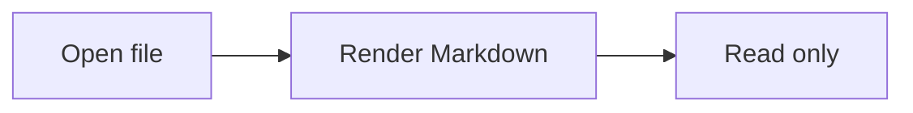

# MdViewer feature gallery

[toc]

## Text and extensions

Plain **bold**, *italic*, ~~struck~~, ++inserted++, ==marked==, H~2~O, x^2^ and :smile:.

*[HTML]: Hyper Text Markup Language

HTML is abbreviated.

Term
: A definition.

A footnote reference.[^note]

[^note]: Footnote text.

| Name | Value |
| :--- | ---: |
| First | 42 |
| Second | 17 |

- [x] A completed task (read-only)
- [ ] An incomplete task (read-only)

> A blockquote with a [section link](#math).

## Code

```rust
fn main() {
    println!("Hello from a viewer, not an editor.");
}
```

## Math

Inline math: $E = mc^2$.

$$
\int_0^1 x^2\,dx = \frac{1}{3}
$$

## Diagrams



## Safe HTML

<details><summary>Expand details</summary><p>Presentational HTML is supported.</p></details>

<script>window.__untrusted = true;</script>

<input value="This editable input must be removed">
<div contenteditable="true" style="position:fixed;inset:0">This is not editable and cannot cover the UI.</div>

## Links

[External link](https://example.com)

[Relative Markdown](plain.md)

## Duplicate heading

## Duplicate heading
